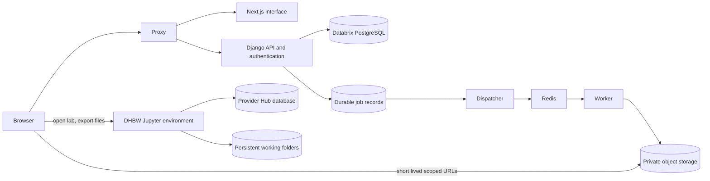

# Architecture and ownership

The two clouds share neither database tables nor mounted directories.
Django owns the course-platform schema; Next.js never opens a database connection.
DHBW owns Hub identities/tokens/server state and editable notebook workspaces.
Django authenticates its own requests independently of Hub availability.

| Category | Authoritative writer | Durable location | Readers |
| --- | --- | --- | --- |
| Accounts, courses, enrollment, progress | Django services | Databrix PostgreSQL | Authorized Django API |
| Official grade and feedback history | Grading service | Databrix PostgreSQL | Scoped instructor/student API |
| Accepted submission metadata | Acceptance worker | Databrix PostgreSQL | Authorized roster and teacher |
| Editable notebooks and kernels | Notebook provider | DHBW workspace | Provider-authorized participants |
| Submitted notebook/output bytes | Acceptance worker | Notebook bucket, accepted prefix | Authorized signed GET |
| Videos/materials | Course editor and validation worker | Course bucket | Enrolled students and course staff |
| Instructor reference solutions | Course editor and validation worker | Assessment bucket | Course instructors only |
| Support images | Ticket owner and validation worker | Support bucket | Owner and scoped support staff |
| Hub operations | JupyterHub | Provider Hub database | Provider only |

## Contracts

- `/api/v1/` is the session-authenticated REST boundary; `/api/v1/schema/` describes it.
- Generated contracts live in [schema.d.ts](../../packages/api-client/schema.d.ts).
- Browser requests use same-origin routing and CSRF cookies; SSR forwards only session cookies.
- SSO headers are consumed only by the trusted nonce-checked callback.
- Notebook launch validates HTTPS host allowlists and operator-confirmed access.
- Public course descriptions are plain text; authored lesson HTML is sanitized on write and read.
- Uploading is staged. Only worker-verified snapshots receive accepted status and a receipt.
- A persisted Job is the recoverable outbox; a Redis publication is a delivery attempt.
- No notebook code executes on the learning platform.

## Compatibility

The original `course` Django app label and migrations 0001–0026 remain.
0027 introduces boundaries and multi-course enrollment; 0028 conservatively attributes historical teams;
0029 stores grading scale/material snapshots and migration provenance; 0030 snapshots the accepted deadline; 0031 preserves legacy grade baselines.
No migration deletes legacy submissions, scores, feedback, or users.
Historical ambiguous peers are never inferred from current team membership.
Legacy sources and raw files remain under `legacy`; they are excluded from production images.

Course-specific `frontend_enabled` switches supported legacy entry routes to Next.js.
Unpublish a course to hide content from students while preserving assessment history.
Deleting a referenced academic record returns 409 instead of destroying grades or artifacts.

## Reference patterns

- [next-forge design-system package](https://github.com/vercel/next-forge/tree/main/packages/design-system)
- [Next.js standalone output](https://nextjs.org/docs/app/api-reference/config/next-config-js/output)
- [JupyterHub operational database](https://jupyterhub.readthedocs.io/en/stable/explanation/database.html)
- [Jupyter document contents storage](https://jupyter-server.readthedocs.io/en/latest/developers/contents.html)
- [Conditional object writes](https://docs.aws.amazon.com/AmazonS3/latest/userguide/conditional-writes.html)
